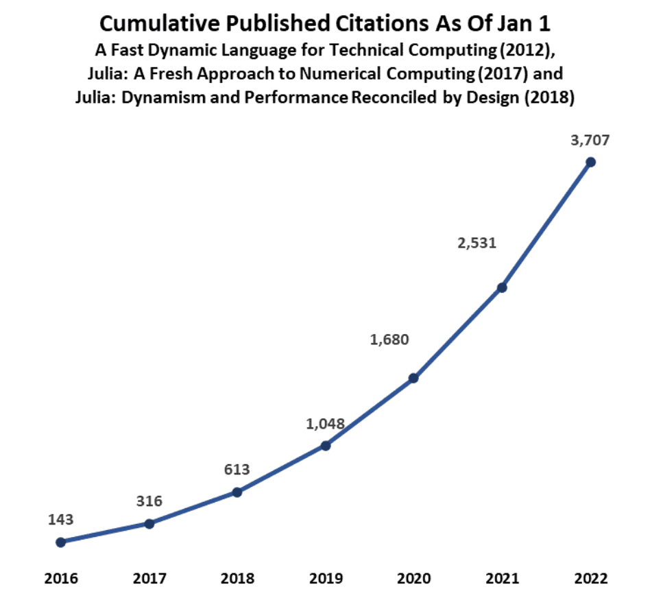
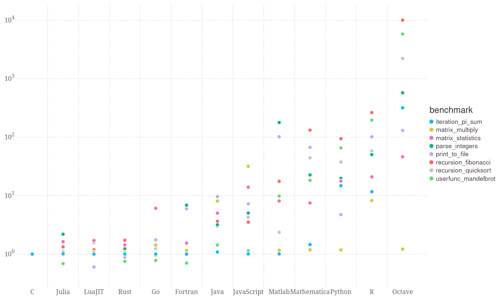

## Course organization (1/3)

::: {.callout-note icon=false}
## Organisation of each class

Each class is divided into two parts:

- a [theoretical lecture]{.emph}, usually with accompanying slides;

- a [recitation]{.emph} comprising pen-and-paper exercises and implementation tasks.

:::

$~$

. . .

::: {.callout-note icon=false}
## Evaluation methods

- Jupyter notebooks to hand in, roughly one per chapter (25%)

- Weekly 15-minute quizzes, based on multiple-choice questions (25%)

- **Midterm exam** with theoretical and practical questions, [without AI]{.alert} (**Bonus for exam**)

- **Final exam** with theoretical and practical questions, [without AI]{.alert} (50%):
  $$
  E = \max \{ E_{final}, 0.4 \times E_{midterm} + 0.6 \times E_{final} \}
  $$
:::

## Course organization (2/3)

::: {.callout-note icon=false}
## Detailed program

-  **Chapter 0** : Introduction to Julia                
-  Chapter 1 : Floating point arithmetic            
-  Chapter 2 : Interpolation and integration        
-  Chapter 3 : Linear systems                       
-  Chapter 4 : Eigenvalue problems                  
-  Chapter 5 : Nonlinear systems                    
-  Chapter 6 : Ordinary differential equations      
:::

. . .

</br>

:::{.callout-caution collapsed="false"}
## Important remarks

- The first notebook is essential for the rest of the course.

- The course advances quickly and requires regular work.

- Unjustified absences will be handled according to NYU policy.
:::

## Course organization (3/3)

::: {.callout-note icon=false}
## Sources of error in computational science

- **Modeling error**: discrepancy between the mathematical model and reality
- **Data error**: uncertainty in the data of the problem
- [Discretization error]{.emph}: error when turning mathematical equations into solvable finite-dimensional problems
- [Discrete solver error]{.emph}: error introduced by the numerical method used to solve the discretized equations
- [Round-off errors]{.emph}: limited accuracy of computer arithmetics

The latter three errors, particularly [discrete solver errors]{.emph},
will be the focus of this course.
:::

. . .

::: {.callout-note icon=false}
## ⚠️ Timetable adjustments

- Friday, October 16: Makeup class.

- Wednesday, December 9: Makeup class.
:::


## Julia, a good language for scientific computing?

|                | Python | Matlab | Julia  | C      |
| ------         | ------ | ------ | ------ | ------ |
| Libre?         | ✔️     | ❌     | ✔️     | ✔️     |
| Fast?          | ❔     | ❔     | ✔️     | ✔️     |
| Easy?          | ✔️     | ✔️     | ✔️     | ❌     |
| Math-friendly? | ❔     | ✔️     | ✔️     | ❌     |
| Ecosystem?     | ✔️     | ❔     | ❔     | ✔️     |

. . .

- `Julia` is easy to learn, read and maintain

- `Julia` is fast: "As simple as Python with the speed of C++"

- `Julia` is well-suited for numerical mathematics

- `Julia` is [libre software]{.emph}

## A bit of history

- Created in 2009 by J. Bezanson, S. Karpinski, V. B. Shah, and A. Edelman

- Excerpt from the Julia Manifesto:

> We want a language that's open source, with a liberal license. We want the
> speed of C with the dynamism of Ruby. We want a language that's homoiconic,
> with true macros like Lisp, but with obvious, familiar mathematical notation
> like Matlab. We want something as usable for general programming as Python, as
> easy for statistics as R, as natural for string processing as Perl, as powerful
> for linear algebra as Matlab, as good at gluing programs together as the shell.
> Something that is dirt simple to learn, yet keeps the most serious hackers
> happy. We want it interactive and we want it compiled.

## Adoption of Julia is rapidly increasing

:::: {.columns}
::: {.column width="50%"}

:::

::: {.column width="50%"}

:::
::::

## Performance benchmark



## Julia is a great fit for numerical mathematics {.smaller}

:::: {.columns}

::: {.column width="50%"}

- [Elegant syntax]{.emph} to define functions

```{julia}
#| eval: true
f(x) = cos(x) + sin(x)
f(1)
```

- The syntax for anonymous functions is equally elegant:

```{julia}
import Plots
Plots.plot(x -> cos(x) + sin(x))
```

- Use of [unicode]{.emph} characters:

```{julia}
ω = 1  # ⚠️ Even emojis work!
f(t) = sin(ω*t)
∇f(t) = ω * cos(ω*t)
f²(t) = f(t) * f(t)
```

- Compiled just in time (`for` loops allowed!):
```{julia}
#| eval: true
@elapsed sum(1/n^2 for n ∈ 1:10^8)
```
In comparison, Python takes about 10 seconds…

:::

::: {.column width="5%"}
:::

::: {.column width="45%" .fragment .fade-up}

- Contains most math functions out of the box:
```{julia}
#| eval: true
π, Float64(ℯ), randn(), √2
```

- Concise syntax, MATLAB-like syntax for matrices:
```{julia}
#| eval: true
M = [1 2 3; 4 5 6]
```

```{julia}
#| eval: true
M[:, [1, 3]]
```

- Great syntax for [array broadcasting]{.emph}:
```{julia}
#| eval: true
broadcast(gcd, 6, [9, 8, 7])
gcd.(6, [9 8 7])
```

```{julia}
#| eval: true
1 .+ [1; 2; 3] .+ [1 1 1; 1 1 1; 1 1 1]
```
:::

::::

## {.smaller}

:::: {.columns}

::: {.column width="45%"}

- [Dynamic types]{.emph} by default...

```{julia}
#| echo: true
#| eval: true
#| code-fold: false
#| code-line-numbers: false
x = 1 ; y = π ; z = 1//2 ; t = x + y + z
```

```{julia}
#| echo: true
#| eval: true
#| code-fold: false
#| code-line-numbers: false
for v ∈ (x, y, z, t)
    println("$v is a $(typeof(v))")
end
```

- ... but [static typing]{.emph} allowed

```{julia}
#| echo: true
#| eval: true
#| code-fold: false
#| code-line-numbers: false
f(x) = 2x
f(x::Float64) = 3x
@show f(1)
@show f(1.) ;
```

- [Array comprehension]{.emph} (`for` within array)

```{julia}
#| echo: true
#| eval: true
#| code-fold: false
#| code-line-numbers: false
A = [63/(i+2j) for i ∈ 1:3, j ∈ 1:3]
```
:::

::: {.column width="5%"}
:::

::: {.column width="45%" .fragment .fade-up}

- Built-in [linear solver]{.emph}

```{julia}
#| echo: true
#| eval: true
#| code-fold: false
#| code-line-numbers: false
x = [1.2, 3.4, 5.6]
b = A*x
A\b
```

```{julia}
#| echo: true
#| eval: true
#| code-fold: false
#| code-line-numbers: false
@show A\b == x
@show A\b ≈ x ;
```

- Array indices [start at 1]{.emph}
```{julia}
#| echo: true
#| eval: true
#| code-fold: false
#| code-line-numbers: false
a = [1, 2, 3]
@show a[1]
@show a[2]
@show a[3]
```


- New binary operators

```{julia}
#| echo: true
#| eval: true
#| code-fold: false
#| code-line-numbers: false
⊕(α,β) = α + β
5 ⊕ 7
```
:::

::::


## Julia's programming paradigm: multiple dispatch {.smaller}

**Wikipedia definition**: *paradigm in which a function or method can be dynamically dispatched based on the run-time type*.

- Example:
```{julia}
#| echo: true
#| eval: true
f(x::Int) = "Int $x"
f(x::Float64) = "Float: $x"
f(x::Any) = "Generic fallback"
f(1.2)
```

- Makes it simple to extend existing packages:

```{julia}
#| eval: true
#| echo: true
import Base.-
function -(s1::String, s2::String)
    return s1[1:length(s1)-length(s2)]
end
"julia" - "ia"
```

- Python, in comparison, uses *single dispach*.

## The REPL and Julia programs {.smaller}

- REPL = read–eval–print loop = "command line"

. . .

- To access the REPL,

  - either type `julia` in a terminal window;

  - or launch it from `VSCode` by typing `Shift+Ctrl+P` then `Julia: Start REPL`

. . .

- Useful shortcuts in the REPL:

  - `]` to access **package mode**

  - `;` to access **shell mode**

  - `?` to access **help mode**

  - `⟵` to return to normal mode

  - `Tab` for automatic completion

  - up and down arrows to navigate history

. . .

- To write a `julia` **program**

  - either write a `.jl` file,
    which can be run using `Shift+Enter`

  - Or write a Jupyter notebook with `.ipynb` extension.

## Package management {.smaller}

To install a new package

- Enter **package mode** with `;`

- Type `add` followed by the package name, e.g.
  ```{julia}
  add Plots
  ```

- You only need to do this once

. . .

To use an installed package

- Either use `import`
  ```{julia}
  import Plots
  Plots.plot(cos)
  ```

- or use `using` (no need to prepend package name later)
  ```{julia}
  using Plots
  plot(cos)
  ```

## Additional references {.smaller}

- Official documentation → <https://docs.julialang.org/en/v1/>

- *Learn X in Y minutes* → <https://learnxinyminutes.com/docs/julia>

- *Intro to Julia tutorial (version 1.0) by Jane Herriman* → <https://youtu.be/8h8rQyEpiZA>

- *The Unreasonable Effectiveness of Multiple Dispatch* → <https://www.youtube.com/watch?v=kc9HwsxE1OY>


<!-- ## References {.smaller .unnumbered .appendix}

::: {#refs}
::: -->
