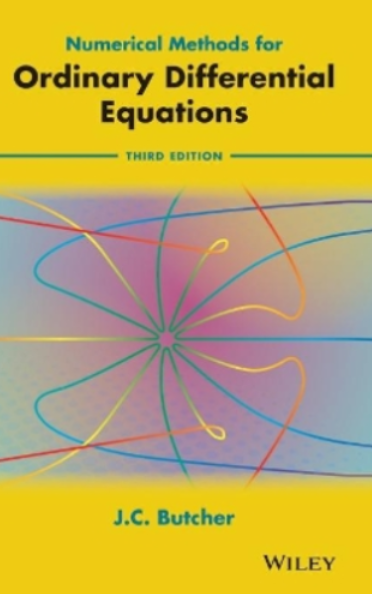

```{julia}
#| echo: false
#| eval: true
#| code-fold: true
#| code-line-numbers: false

using Plots
using LaTeXStrings
Plots.default(label=nothing,
              fontfamily="Computer Modern",
              background_color=colorant"#f5ede9",
              foreground_color=:black,
              linewidth=2,
              xlabelfontsize=18,
              ylabelfontsize=18,
              legendfontsize=18,
              titlefontsize=18,
              xtickfontsize=18,
              ytickfontsize=18,
              bottom_margin=5Plots.mm,);
```

# Introduction

## Objective




:::: {.columns}

::: {.column width="48%"}
:::{.callout-note}
## Goal of this chapter
Study numerical methods to solve [initial value problems]{.blue}:
$$
\left \{
\begin{aligned}
    & \vect x'(t) = \vect f\bigl(t, \vect x(t)\bigr), \\
    & \vect x(t_0) = \vect x_0.
\end{aligned}
\right.
$$ {#eq-ode}
where $\vect f\colon \real \times \real^n \to \real^n$.
:::

::: {.fragment}
:::{.callout-tip}
## Application examples

- Lagrangian mechanics;

- Celestial mechanics;

- Electric circuits;

- Time-dependent partial differential equations:
  $$
  \left \{
  \begin{aligned}
  \partial_t u &= \partial_x^2 u \\
  u(0, x) &= u_0(x).
  \end{aligned}
  \right.
  \xrightarrow{\text{discretization}}
  \left \{
  \begin{aligned}
  \vect x' &= \mat A \vect x. \\
  \vect x(0) &= \vect x_0.
  \end{aligned}
  \right.
  $$
  $\thus$ ubiquitous in science.

:::
:::
:::

:::

::: {.column width="5%"}
:::

::: {.column width="45%"}
::: {.fragment}
:::{.callout-warning}
## Remark: higher-order differential equations
Initial value problems of higher order can be recast in form @eq-ode.

**Example**: charged particle (wih mass and charge 1) in electric field:
$$
\vect x''(t) = \vect E\bigl(\vect x(t)\bigr).
$$
Introducing $\vect v = \vect x'$,
we rewrite this equation as
$$
\left \{
\begin{aligned}
    & \vect v'(t) = \vect E\bigl(\vect x(t)\bigr), \\
    & \vect x'(t) = \vect v(t).
\end{aligned}
\right.
$$
:::
:::

::: {.fragment}
:::{.callout-warning}
## Remark: a useful particular case
When $\vect f(t, \vect x) = \vect f(t)$, the solution is [an integral]{.blue}:
$$
\vect x(t) = \vect x_0 + \int_{t_0}^{t} \vect f(t) \, \d t.
$$
$\thus$ useful to guess order of convergence of numerical methods
:::
:::

::::

## Analysis of the continuous problem

::: {.column width="38%"}

:::{.callout-note}
## Definition: [local]{.blue}, [maximal]{.blue}, [global]{.blue} solution
A function $\vect x \colon I \to \real^n$ is a [local solution]{.blue} if $t_0 \in I$ and
$$
\left \{
\begin{aligned}
    & \vect x'(t) = \vect f\bigl(t, \vect x(t)\bigr) \qquad \forall t \in I \\
    & \vect x(t_0) = \vect x_0.
\end{aligned}
\right.
$$
A local solution $\vect x \colon I \to \real^n$ is [maximal]{.blue} if it has no extension to a larger interval,
and [global]{.blue} if $I = \real$.
:::

::: {.fragment}
:::{.callout-tip}
# Example
Consider the equation
$$
    \left \{
    \begin{aligned}
        & x'(t) = x(t)^2, \\
        & x(0) = 1.
    \end{aligned}
    \right.
$$
The solution $x_* \colon (-\infty, 1) \to \real$ given by
$$
    \vect x_*(t) = \frac{1}{1-t}.
$$
is [maximal]{.blue} but not [global]{.blue}.
:::
:::
:::

::: {.column width="3%"}
:::

::: {.column width="57%"}
::: {.fragment}
:::{.callout-note}
## Theorem: existence and uniqueness

Suppose that

- The function $\vect f$ is continuous;

- For any bounded set $D \subset \real \times \real^n$ containing $(t_0, \vect x_0)$,
  there is $L(D)$ such that
  $$
    \forall \bigl((t, \vect x_1), (t, \vect x_2)\bigr) \in D \times D, \qquad
    \norm{ \vect f(t, \vect x_1) - \vect f(t, \vect x_2) } \leq L \norm{\vect x_1 - \vect x_2}.
  $$

Then

- There exists a unique maximal solution $\vect x_* \colon (T_-, T_+) \to \real^n$;

- **Blow-up**:
  If $T_+$ is finite, then $\lim_{t \to T_+} \norm{\vect x(t)} = \infty$,
  and similarly for $T_-$.
:::
:::

$~$

::: {.fragment}
From now on, [$t_0 = 0$]{.blue} for simplicity.
:::

:::


## Toy problem {auto-animate=true}

::: {.column width="35%"}

:::{.callout-tip}
## Toy problem
For numerical illustration,
we consider the equation
$$
\left\{
\begin{aligned}
x'(t) &= \alpha \bigl(x(t) - \sin(t) \bigr) + \cos(t) \\
x(0) &= x_0.
\end{aligned}
\right.
$$

- The exact solution is given by

  $$x(t) = \sin(t) + e^{\alpha t} x_0.$$

- Solutions converge if $\alpha < 0$, and diverge if $\alpha > 0$.
:::
:::

::: {.column width="1%"}
:::

::: {.column width="62%"}
```{julia}
#| echo: false
#| eval: true
#| code-fold: true
#| code-line-numbers: false
f(t, x) = α * (x - sin(t)) + cos(t)
sol(t₀, x₀) = t -> sin(t) + exp(α*(t - t₀)) * (x₀ - sin(t₀))

α = -1
x0s = -2:.2:2
plot(size=(900, 600))
for x0 in x0s
    plot!(sol(0, x0), xlims=(0, 10), color=:gray)
end
annotate!(5, 1.5, text(L"\alpha = " * string(α), :left), fontsize=24)
plot!(sol(0, 0), xlims=(0, 10), color=:green, label=L"\sin(t)")
plot!(xlabel=L"t", bg=:transparent)
```
:::

## Toy problem {auto-animate=true}

::: {.column width="35%"}

:::{.callout-tip}
## Toy problem
For numerical illustration,
we consider the equation
$$
\left\{
\begin{aligned}
x'(t) &= \alpha \bigl(x(t) - \sin(t) \bigr) + \cos(t) \\
x(0) &= x_0.
\end{aligned}
\right.
$$

- The exact solution is given by

  $$x(t) = \sin(t) + e^{\alpha t} x_0.$$

- Solutions converge if $\alpha < 0$, and diverge if $\alpha > 0$.
:::
:::

::: {.column width="1%"}
:::

::: {.column width="62%"}
```{julia}
#| echo: false
#| eval: true
#| code-fold: true
#| code-line-numbers: false
α = 0
x0s = -2:.2:2
plot(size=(900, 600))
for x0 in x0s
    plot!(sol(0, x0), xlims=(0, 10), color=:gray)
end
annotate!(4.5, 2.5, text(L"\alpha = " * string(α), :left))
plot!(sol(0, 0), xlims=(0, 10), color=:green, label=L"\sin(t)")
plot!(xlabel=L"t", bg=:transparent)
```
:::

## Toy problem {auto-animate=true}

::: {.column width="35%"}

:::{.callout-tip}
## Toy problem
For numerical illustration,
we consider the equation
$$
\left\{
\begin{aligned}
x'(t) &= \alpha \bigl(x(t) - \sin(t) \bigr) + \cos(t) \\
x(0) &= x_0.
\end{aligned}
\right.
$$

- The exact solution is given by

  $$x(t) = \sin(t) + e^{\alpha t} x_0.$$

- Solutions converge if $\alpha < 0$, and diverge if $\alpha > 0$.
:::
:::

::: {.column width="1%"}
:::

::: {.column width="62%"}
```{julia}
#| echo: false
#| eval: true
#| code-fold: true
#| code-line-numbers: false
α = 1
x0s = LinRange(-.0001, .0001, 20)
plot(size=(900, 600))
for x0 in x0s
    plot!(sol(0, x0), xlims=(0, 10), color=:gray)
end
annotate!(5, 1.5, text(L"\alpha = " * string(α), :left))
plot!(sol(0, 0), xlims=(0, 10), color=:green, label=L"\sin(t)")
plot!(xlabel=L"t", bg=:transparent)
```
:::

# The forward and backward Euler methods

## The forward Euler method

::: {.column width="60%"}
:::{.callout-note}
## The method
The forward Euler method is the iteration
$$
\vect x_{n+1} = \vect x_{n} + \Delta \vect f(t_n, \vect x_n),
$$
with $\Delta$ the time step.
:::

::: {.fragment}
:::{.callout-warning}
## Remark: link with numerical quadrature
When $\vect f(t, \vect x) = \vect f(t)$,
the method performs the approximation
$$
\int_0^{n \Delta} \vect f(t) \, \d t \approx \sum_{i=0}^{n-1} \Delta  \vect f(i \Delta).
$$
$\thus$ This is the [left endpoint rule]{.blue} for numerical integration.

$\thus$ The error scales as $\mathcal O(\Delta)$ in this case.

**Question**: is this true in general?
:::
:::

:::

::: {.column width="3%"}
:::

::: {.column width="35%"}

:::

## The forward Euler method: geometric interpretation

::: {.column width="35%"}
:::{.callout-tip}
## Example problem
We consider the toy problem from the beginning:
$$
    \left\{
    \begin{aligned}
    x'(t) &= \alpha \bigl(x(t) - \sin(t) \bigr) + \cos(t) \\
    x(0) &= 0,
    \end{aligned}
    \right.
$$
with $\alpha = 0.15$.
:::
:::

::: {.column width="1%"}
:::

::: {.column width="62%"}
```{julia}
#| echo: false
#| eval: true
#| code-fold: false
#| code-line-numbers: false
α = .15

f(t, x) = α * (x - sin(t)) + cos(t)
sol(t₀, x₀) = t -> sin(t) + exp(α*(t - t₀)) * (x₀ - sin(t₀))
x₀ = 0
ylims = (-1.2, 3)
N = 10

# f(t, x) = α * x
# sol(t₀, x₀) = t -> x₀ * exp(α * (t - t₀))
# x₀ = 1
# ylims = (.5, 5)
# N = 4

T = 10.
ts = LinRange(0, T, N)
Δ = ts[2]
xs = zero(ts)
xs[1] = x₀

anim = Animation()
for i in 1:length(ts) - 1
    plot(size=(900, 600))
    plot!(sol(ts[1], xs[1]), xlims=(0, T + 1), color=:green)
    for j in 2:i-1
        plot!(sol(ts[j], xs[j]), xlims=(ts[j], T + 1), color=:lightgray)
    end
    scatter!(ts[1:i], xs[1:i], color=:red)
    plot!(ts[1:i], xs[1:i], color=:blue)
    plot!(sol(ts[i], xs[i]), xlims=(ts[i], T), color=:gray)
    plot!(xlims=(0, T), ylims=ylims)
    frame(anim)
    xs[i + 1] = xs[i] + Δ*f(ts[i], xs[i])
    scatter!(ts[1:i+1], xs[1:i+1], color=:red)
    plot!(ts[1:i+1], xs[1:i+1], color=:blue)
    frame(anim)
end
gif(anim, "forward_euler.gif", fps=1)
```
:::

## The forward Euler method: illustration of the convergence

```{julia}
#| echo: false
#| eval: true
#| code-fold: false
#| code-line-numbers: false
function forward_euler(f, x₀, Δ, T)
    ts = 0:Δ:T
    xs = zero(ts)
    xs[1] = x₀
    for i in 1:length(ts) - 1
        xs[i + 1] = xs[i] + Δ*f(ts[i], xs[i])
    end
    return ts, xs
end

T = 10
Δs = 2.0.^(0:-1:-6)
anim = @animate for Δ in Δs
    ts, xs = forward_euler(f, x₀, Δ, T)
    plot(size=(900, 600), xlabel=L"t", bottom_margin=5Plots.mm)
    plot!(sol(0, x₀), xlims=(0, T), ylims=ylims, color=:green)
    scatter!(ts, xs, color=:red)
    plot!(ts, xs, color=:blue)
    error = maximum(abs.(sol(0, x₀).(ts) - xs))
    annotate!(.5, 2.5, text(L"\Delta = " * string(Δ), :left))
    annotate!(.5, 2.0, text(L"\max_n |x(t_n) - x_n| = " * string(error), :left))
end
gif(anim, "convergence.gif", fps=1)
```

## Estimating the rate of convergence numerically

::: {.column width="35%"}
:::{.callout-tip}
## Estimation of the order of convergence
**Question:** how to estimate the [order $p$]{.blue}?
$$
\max_n |x(t_n) - x_n| = \mathcal O(\Delta^{\color{blue} p})
$$

**Answer**: assume that
$$
u(Δ) = C \Delta^{\color{blue} p}.
$$
Then
$$
\log\bigl(u(\Delta)\bigr)
= \log C + {\color{blue} p} \log(\Delta)
$$
In other words, [$\log(u)$]{.blue} is an [affine]{.green} function of [$\log(\Delta)$]{.blue}!

$\thus$ Enables calculating [$p$]{.blue} using linear fit.
:::
:::

::: {.column width="60%"}
::: {.fragment}

```{julia}
#| echo: false
#| eval: true
#| code-fold: false
#| code-line-numbers: false
α = .15
Δs = 2.0.^(0:-1:-10)
errors = zero(Δs)
for (i, Δ) in enumerate(Δs)
    ts, xs = forward_euler(f, x₀, Δ, T)
    xexact = sin
    errors[i] = maximum(abs.(xs - xexact.(ts)))
end
plot(Δs, errors, seriestype=[:line,:scatter],
     xscale=:log, yscale=:log, bg=:transparent,
     size=(1000, 700), xlabel=L"\Delta", title=L"\max_n|x(t_n) - x_n|",
     bottom_margin=5Plots.mm)
```
:::

::: {.fragment}
```{julia}
#| echo: true
#| eval: true
using Polynomials
fit(log.(Δs), log.(errors), 1)
```
:::
:::

## The forward Euler method: error analysis

::: {.column width="41%"}
:::{.callout-note}
## Convergence theorem
Assume that

- there exists a unique solution $\vect x(t) \colon [0, T] \to \real^n$, in $C^2$ with
  $$
  M := \sup_{t \in [0,T]} \norm{\vect x''(t)}.
  $$

- the function $\vect f(t, \vect x)$ is globally Lipschitz in $\vect x$ with constant $L$.

Then the following error estimate holds:
\begin{equation}
    \forall n,
    \quad
    \norm{\vect x(t_n) - \vect x_n}
    \leq
    \frac{{\color{blue} \Delta} M}{2} \left( \frac{\e^{L t_n} - 1}{L} \right),
\end{equation}
:::

<!-- :::{.callout-warning} -->
<!-- ## Remark: local truncation error -->
<!-- The global error scales similarly to the local truncation error -->
<!-- $$\vect \eta_{n+1} := \frac{\vect x(t_{n+1}) - \vect x(t_n)}{\Delta} - \vect f \bigl(t_n, \vect x(t_n)\bigr)$$ -->
<!-- ::: -->

:::

::: {.column width="1%"}
:::

::: {.column width="50%"}
::: {.fragment}
:::{.callout}
## Proof ([dimension 1]{.blue} for simplicity)
- Let $e_n = x(t_n) - x_n$. By Taylor, there is $\tau_n \in [t_n, t_{n+1}]$ such that
  $$
    e_n = e_{n-1} + \Delta \Bigl( f\bigl(t_{n-1}, x(t_{n-1})\bigr) - f\bigl(t_{n-1}, x_{n-1}\bigr) \Bigr) + \frac{\Delta^2}{2} x''(\tau_n).
  $$

- By Lipschitz continuity,
  $$
  \abs{e_{n}} \leq (1 + \Delta L) \abs{e_{n-1}} + \frac{M \Delta^2}{2}.
  $$

- Iterating this inequality, we deduce
  $$
  \begin{aligned}
  |e_{n}|
  &\leq (1 + \Delta L) \Bigl( (1 + \Delta L) \abs{e_{n-2}} + \frac{M \Delta^2}{2} \Bigr) +  \frac{M \Delta^2}{2}\\
  &\leq \dotsc
  \leq (1 + \Delta L)^{n} \abs{e_{0}} + \sum_{i=1}^{n} (1 + \Delta L)^{n-i} \frac{M \Delta^2}{2}.
  \end{aligned}
  $$
- Using the formula for geometric series,
  we have
  $$
  \abs{e_{n}}
  \leq (1 + \Delta L)^{n} \abs{e_{0}} + \frac{(1+\Delta L)^{n} - 1}{\Delta L} \left( \frac{\Delta^2 M}{2} \right).
  $$
:::
:::
:::


## The forward Euler method: numerical instability {auto-animate=true}

::: {.column width="40%"}
:::{.callout-note}
## Definition: numerical instability
A method is [numerically unstable]{.blue} when the numerical solution diverges but the exact solution does not.
:::

:::{.callout-tip}
## Example problem
Consider the toy problem from the beginning
$$
    \left\{
    \begin{aligned}
    x'(t) &= f(t, x) := \alpha \bigl(x(t) - \sin(t) \bigr) + \cos(t) \\
    x(0) &= x_0.
    \end{aligned}
    \right.
$$

- For $\alpha < 0$, exact solutions converge with time scale $|\alpha|^{-1}$.

- For $\alpha \ll -1$, presence of two widely separated time scales.

  $\thus$ short scale $|\alpha|^{-1}$, and long scale $2\pi$ (period of $\sin$)

  $\thus$ the equation is called [stiff]{.blue}.

- We observe numerical instability if $|1 + \Delta \alpha| > 1$. [Why?]{.blue}

  $\thus$ in general, numerical stability depends on shortest scale.

:::
:::

::: {.column width="1%"}
:::

::: {.column width="55%"}
$\alpha = -10$, $\Delta = .18$

$~$
```{julia}
#| echo: false
#| eval: true
#| code-fold: false
#| code-line-numbers: false
α = -10
T = 2
Δ = .18
x₀ = 1.
f(t, x) = α * (x - sin(t)) + cos(t)
sol(t₀, x₀) = t -> sin(t) + exp(α*(t - t₀)) * (x₀ - sin(t₀))
ts, xs = forward_euler(f, x₀, Δ, T)
plot(ts, xs, seriestype=[:line,:scatter])
for (t, x) in zip(ts, xs)
    plot!(sol(t, x), xlims=(t, T), c=:lightgray)
end
plot!(sol(0, x₀), xlims=(0, T), c=:green, bg=:transparent)
```
:::


## The forward Euler method: numerical instability {auto-animate=true}

::: {.column width="40%"}
:::{.callout-note}
## Definition: numerical instability
A method is [numerically unstable]{.blue} when the numerical solution diverges but the exact solution does not.
:::

:::{.callout-tip}
## Example problem
Consider the toy problem from the beginning
$$
    \left\{
    \begin{aligned}
    x'(t) &= f(t, x) := \alpha \bigl(x(t) - \sin(t) \bigr) + \cos(t) \\
    x(0) &= x_0.
    \end{aligned}
    \right.
$$

- For $\alpha < 0$, exact solutions converge with time scale $|\alpha|^{-1}$.

- For $\alpha \ll -1$, presence of two widely separated time scales.

  $\thus$ short scale $|\alpha|^{-1}$, and long scale $2\pi$ (period of $\sin$)

  $\thus$ the equation is called [stiff]{.blue}.

- We observe numerical instability if $|1 + \Delta \alpha| > 1$. [Why?]{.blue}

  $\thus$ in general, numerical stability depends on shortest scale.

:::
:::

::: {.column width="1%"}
:::

::: {.column width="55%"}
$\alpha = -10$, $\Delta = .22$

$~$
```{julia}
#| echo: false
#| eval: true
#| code-fold: false
#| code-line-numbers: false
α = -10
T = 2
Δ = .22
x₀ = 1.
f(t, x) = α * (x - sin(t)) + cos(t)
sol(t₀, x₀) = t -> sin(t) + exp(α*(t - t₀)) * (x₀ - sin(t₀))
ts, xs = forward_euler(f, x₀, Δ, T)
plot(ts, xs, seriestype=[:line,:scatter])
for (t, x) in zip(ts, xs)
    plot!(sol(t, x), xlims=(t, T), c=:lightgray)
end
plot!(sol(0, x₀), xlims=(0, T), c=:green, bg=:transparent)
```
:::


## Absolute stability

::: {.column width="40%"}
:::{.callout-note}
## Definition: [absolute stability]{.blue}
Consider the [model equation]{.green}
$$
    \left\{
    \begin{aligned}
        x'(t) &= \lambda x(t), \\
        x(0) &= 1.
    \end{aligned}
    \right.
$$
A numerical scheme is called [absolutely stable]{.blue} if
$$
    \lvert x_n \rvert \xrightarrow[n \to \infty]{} 0.
$$
The [absolute stability region]{.blue} is by definition
$$
    \mathcal A := \{ z \in \complex : \text{$\abs{x_n} \to 0$ when $\Delta \lambda = z$} \} \subset \complex.
$$
:::

::: {.fragment}
:::{.callout-tip}
## Absolute stability of the forward Euler method
The forward Euler iteration for the [model equation]{.green} reads
$$
    x_{n+1} = x_n + \Delta \lambda x_n = (1 + \Delta \lambda) x_n.
$$
The scheme is absolutely stable iff $|1 + \Delta \lambda| < 1$.
:::
:::

:::

::: {.column width="3%"}
:::

::: {.column width="55%"}
::: {.fragment}
```{julia}
#| echo: true
#| eval: true
#| code-fold: false
#| code-line-numbers: false
xlims, ylims = (-5, 1), (-2, 2)
x = LinRange(xlims..., 200)
y = LinRange(ylims..., 200)
stable = @. clamp(abs(1 + x' + im*y), 0, 2)
Plots.contourf(x, y, stable, c=cgrad(:Pastel1_3, rev=true),
               aspect_ratio=:equal, levels=[0., 1., 2.],
               xlabel=L"\Re(\Delta \lambda)",
               ylabel=L"\Im(\Delta \lambda)",
               xlims=xlims, ylims=ylims, bg=:transparent)
Plots.contour!(x, y, stable, color=:red,
               levels=[0., 1., 2.], colorbar=:none)
Plots.vline!([0], color=:gray)
Plots.hline!([0], color=:gray)
```
:::
:::

## Absolute stability: illustration for model equation {auto-animate=true}

::: {.column width="30%"}
:::{.callout-tip}
## Example problem
Consider the equation
$$
    \left\{
    \begin{aligned}
        x'(t) &= - x(t), \\
        x(0) &= 1.
    \end{aligned}
    \right.
$$
Absolute stability of forward Euler if [$\Delta < 2$]{.blue}.
:::
:::

::: {.column width="3%"}
:::

::: {.column width="65%"}
$\Delta = \frac{1}{2}$

$~$
```{julia}
#| echo: false
#| eval: true
#| code-fold: false
#| code-line-numbers: false
T = 10
Δ = .5
ts = 0:Δ:T
xs = (1 - Δ).^(0:length(ts))
plot(ts, xs, seriestype=[:line,:scatter], size=(900, 600))
plot!(t -> exp(-t), xlims=(0, T), c=:green, bg=:transparent,
      label="Exact solution")
```
:::

## Absolute stability: illustration for model equation {auto-animate=true}

::: {.column width="30%"}
:::{.callout-tip}
## Example problem
Consider the equation
$$
    \left\{
    \begin{aligned}
        x'(t) &= - x(t), \\
        x(0) &= 1.
    \end{aligned}
    \right.
$$
Absolute stability of forward Euler if [$\Delta < 2$]{.blue}.
:::
:::

::: {.column width="3%"}
:::

::: {.column width="65%"}
$\Delta = 2$

$~$
```{julia}
#| echo: false
#| eval: true
#| code-fold: false
#| code-line-numbers: false
T = 10
Δ = 2
ts = 0:Δ:T
xs = (1 - Δ).^(0:length(ts))
plot(ts, xs, seriestype=[:line,:scatter], size=(900, 600))
for (t, x) in zip(ts, xs)
    plot!(s -> x*exp(-(s-t)), xlims=(t, T), c=:lightgray)
end
plot!(t -> exp(-t), xlims=(0, T), c=:green, bg=:transparent)
```
:::


## Absolute stability: illustration for model equation {auto-animate=true}

::: {.column width="30%"}
:::{.callout-tip}
## Example problem
Consider the equation
$$
    \left\{
    \begin{aligned}
        x'(t) &= - x(t), \\
        x(0) &= 1.
    \end{aligned}
    \right.
$$
Absolute stability of forward Euler if [$\Delta < 2$]{.blue}.
:::
:::

::: {.column width="3%"}
:::

::: {.column width="65%"}
$\Delta = 2.5$

$~$
```{julia}
#| echo: false
#| eval: true
#| code-fold: false
#| code-line-numbers: false
T = 10
Δ = 2.5
ts = 0:Δ:T
xs = (1 - Δ).^(0:length(ts))
plot(ts, xs, seriestype=[:line,:scatter], size=(900, 600))
for (t, x) in zip(ts, xs)
    plot!(s -> x*exp(-(s-t)), xlims=(t, T), c=:lightgray)
end
plot!(t -> exp(-t), xlims=(0, T), c=:green, bg=:transparent)
```
:::

## The main application of absolute stability: PDEs

::: {.column width="10%"}
:::

::: {.column width="70%"}
:::{.callout-tip}
## Example: heat equation
[Space]{.blue} discretization of the heat equation
$$
\left \{
\begin{aligned}
&\partial_t u = \partial_x^2 u, \\
&u(t, 0) = u(t, 1) = 0,
\end{aligned}
\right.
$$
by the [finite difference method]{.blue} leads to the differential equation
$$
    \vect u' := \mat A \vect u,
    \qquad
    \mat A :=
    \frac{1}{h^2}
    \begin{pmatrix}
        -2 & 1 \\
        1 & -2  & 1 \\
           & 1 & -2      & 1 \\
           &    & \ddots & \ddots & \ddots & \\
           &    &        & 1    & -2      & 1 \\
           &    &        &     & 1      & -2 \\
    \end{pmatrix},
$$
where $h$ is the spatial step.
The **forward Euler method** for this system reads
$$
\vect u_{n+1}
= \vect u_{n} + \Delta \mat A \vect u_{n}
= (\mat I + \Delta \mat A) \vect u_{n}.
$$
$\thus$ numerical stability if $\Delta \lambda \in \mathcal A$, i.e. $|1 + \Delta \lambda|< 1$, for any eigenvalue $\lambda$ of $\mat A$.

$\thus$ since $\max_i |\lambda_i| \propto \frac{1}{h^2}$, stability requires [$\Delta = \mathcal O(h^2)$]{.red}…
:::
:::

## The backward Euler method

::: {.column width="45%"}
:::{.callout-note}
## The method
The [backward]{.red} Euler method is the iteration
$$
\vect x_{n+1} = \vect x_{n} + \Delta \vect f({\color{red}t_{n+1}}, {\color{red}\vect x_{n+1}}),
$$
with $\Delta$ the time step.

$\thus$ Nonlinear equation to solve at each step!

$\thus$ A fixed point iteration is the simplest approach to solve this equation:
$$
{\color{magenta}\vect x_{n+1}^{(k+1)}} = \vect x_{n} + \Delta \vect f(t_n, {\color{magenta}\vect x_{n+1}^{(k)}}).
$$
:::

::: {.fragment}
:::{.callout-warning}
## Remark: link with numerical quadrature
When $\vect f(t, \vect x) = \vect f(t)$,
the method performs the approximation
$$
\int_0^{n \Delta} \vect f(t) \, \d t \approx \sum_{i=1}^{n} \Delta  \vect f(i \Delta).
$$
$\thus$ This is the [right endpoint rule]{.blue} for numerical integration.

$\thus$ The error scales as $\mathcal O(\Delta)$ in this case.
:::
:::
:::

::: {.column width="3%"}
:::

::: {.column width="50%"}
::: {.fragment}
:::{.callout-note}
## Proposition absolute stability
The stability region of the backward Euler method is
$$
\mathcal A = \left\{ z \in \complex: \frac{1}{|1 - \Delta \lambda|} < 1 \right\}
$$
:::
:::


::: {.fragment}
```{julia}
#| echo: false
#| eval: true
#| code-fold: false
#| code-line-numbers: false
xlims, ylims = (-1, 5), (-2, 2)
x = LinRange(xlims..., 200)
y = LinRange(ylims..., 200)
stable = @. clamp(abs(1 / (1 - x' - im*y)), 0, 2)
Plots.contourf(x, y, stable, c=cgrad(:Pastel1_3, rev=true),
               aspect_ratio=:equal, levels=[0., 1., 2.],
               xlabel=L"\Re(\Delta \lambda)",
               ylabel=L"\Im(\Delta \lambda)",
               xlims=xlims, ylims=ylims, bg=:transparent)
Plots.contour!(x, y, stable, levels=[0., 1., 2.], color=:red, colorbar=:none)
Plots.vline!([0], color=:gray)
Plots.hline!([0], color=:gray)
```
:::

::: {.fragment}
$\thus$ Stable for all $\Re(\Delta \lambda) < 0$, "[unconditional stability]{.blue}"
:::
:::

## Absolute stability: illustration for model equation {auto-animate=true}

::: {.column width="30%"}
:::{.callout-tip}
## Example problem
Consider the equation
$$
    \left\{
    \begin{aligned}
        x'(t) &= - x(t), \\
        x(0) &= 1.
    \end{aligned}
    \right.
$$
Absolute stability [for all $\Delta > 0$]{.green}!
:::
:::

::: {.column width="3%"}
:::

::: {.column width="65%"}
$\Delta = 2.5$

$~$
```{julia}
#| echo: false
#| eval: true
#| code-fold: false
#| code-line-numbers: false
T = 10
Δ = 2.5
ts = 0:Δ:T
xs = (1/(1 + Δ)).^(0:length(ts))
plot(ts, xs, seriestype=[:line,:scatter], size=(900, 600))
for (t, x) in zip(ts, xs)
    plot!(s -> x*exp(-(s-t)), xlims=(t, T), c=:lightgray)
end
plot!(t -> exp(-t), xlims=(0, T), c=:green, bg=:transparent)
```
:::

# Higher-order one-step methods

## Explicit Taylor methods

::: {.column width="50%"}
:::{.callout-tip}
## Motivating idea

By differentiating the equation
$$
\vect x'(t) = \vect f\bigl(t, \vect x(t)\bigr),
$$
we have access to higher-order derivatives of $\vect x$, e.g.
$$
\begin{aligned}
\vect x'' &= \vect f_2\bigl(t, \vect x(t)\bigr),
\qquad \vect f_2(t, \vect x) := (\partial_t + \vect f(t, \vect x) \cdot \nabla_{\vect x}) \vect f(t, \vect x) \\
\vect x''' &= \vect f_3\bigl(t, \vect x(t)\bigr),
\qquad \vect f_3(t, \vect x) := (\partial_t + \vect f(t, \vect x) \cdot \nabla_{\vect x}) \vect f_2(t, \vect x), \\
&\dots
\end{aligned}
$$
This motivates the so-called [Taylor methods]{.blue}:
$$
\vect x_{n+1} = \vect x_n + \Delta \vect f(t_n, \vect x_n) + \frac{\Delta^2}{2} \vect f_2(t_n, \vect x_n) + \dotsc + \frac{\Delta^p}{p!} \vect f_p(t_n, \vect x_n).
$$
:::

::: {.fragment}
:::{.callout-warning}
## Remarks

- Note that for $p = 1$, this is the forward Euler method;

- The error scales as $\mathcal O(\Delta^p)$ under appropriate assumptions.

- By construction, exact when $\vect x(t)$ is polynomial of degree $p$.
:::
:::
:::

::: {.column width="3%"}
:::

::: {.column width="40%"}
::: {.fragment}
:::{.callout-note}
## Proposition: absolute stability
The absolute stability region of the Taylor method is
$$
\mathcal A = \left\{ z \in \complex: \left|1 + z + \dotsc + \frac{z^p}{p!} \right| < 1 \right\}
$$
:::
:::

::: {.fragment}
```{julia}

xlims = (-6, 2)
ylims = (-4, 4)
Plots.plot(size=(900, 600))
x = LinRange(xlims..., 400)
y = LinRange(ylims..., 400)
is_stable(z, p) = abs(sum(z^i/factorial(i) for i in 0:p)) < 1
stable = sum(is_stable.(x' .+ im*y, p) for p in 1:4)
Plots.contourf!(x, y, stable, c=:Pastel1_3, bg=:transparent,
                aspect_ratio=:equal, levels=[0, 1, 2, 3, 4, 5],
                xlabel=L"\Re(\Delta \lambda)",
                ylabel=L"\Im(\Delta \lambda)",
                colorbar=:none, xlims=xlims, ylims=ylims)
Plots.contour!(x, y, stable, levels=5, c=:red)
Plots.vline!([0], color=:gray)
Plots.hline!([0], color=:gray)
```
:::
:::

## Runge-Kutta methods

::: {.column width="45%"}
:::{.callout-note}
## Definition: explicit Runge-Kutta method
An explicit Runge--Kutta method with $p$ stages is of the form
$$
\begin{aligned}
    \vect x_{n+1} &= \vect x_n + \Delta \sum_{i=1}^p b_i \vect k_i \\
    \vect k_1 &= \vect f(t_n, \vect x_n),  \\
    \vect k_2 &= \vect f\bigl(t_n + c_2 \Delta, \vect x_n+\Delta(a_{21} \vect k_1)\bigr), \\
    \vect k_3 &= \vect f\bigl(t_n + c_3 \Delta, \vect x_n+\Delta(a_{31} \vect k_1 + a_{32} \vect k_2)\bigr), \\
              &\;\;\vdots \\
    \vect k_p &= \vect f\left(t_n + c_p \Delta, \vect x_n + \Delta \sum_{j = 1}^{p-1} a_{pj} \vect k_j\right),
\end{aligned}
$$

$\thus$ Derivatives of $\vect f$ not necessary!
:::

::: {.fragment}
:::{.callout-warning}
## Remarks
- Construction tedious and not discussed here;

- Most widely used in applications;

- Error scales as $\mathcal O(\Delta^p)$ for appropriate coefficients;
:::
:::


:::

::: {.column width="3%"}
:::

::: {.column width="50%"}

::: {.fragment}
:::{.callout-tip}
## Example: Heun's method
Heun's method is a Runge-Kutta method of order 2 and reads
$$
    \vect x_{n+1} = \vect x_n
    + \frac{\Delta}{2}\vect f(t_n, \vect x_n)
    + \frac{\Delta}{2} \vect f \bigl( t_n + \Delta, \vect x_n + \Delta \vect f(t_n, \vect x_n) \bigr).
$$
:::
:::

::: {.fragment}
:::{.callout-note}
## Proposition: same stability region as Taylor's method
The absolute stability region of a Runge-Kutta method of order $p$ is
$$
\mathcal A = \left\{ z \in \complex: \left|1 + z + \dotsc + \frac{z^p}{p!} \right| < 1 \right\}
$$
:::

:::
:::

## Further readings

::: {.column width="50%"}
Some of the topics we did not cover include

- Multistep methods;

- Implicit Runge-Kutta methods;

- Adaptive time-stepping;

- Symplectic schemes for Hamiltonian systems;

- ...
:::

::: {.column width="1%"}
:::

::: {.column width="45%"}

:::
